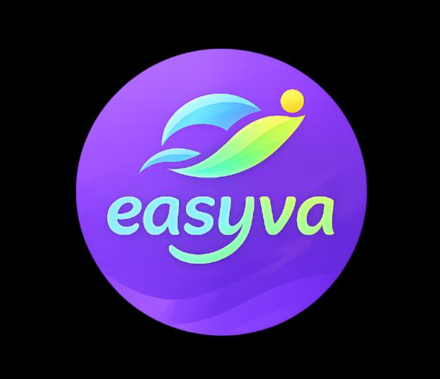

<div align="center">



# Easyva — Artisan & Living Decor E-Commerce Platform

**Direct-to-Consumer (D2C) Artisan Marketplace connecting heritage craftsmen of Tamil Nadu with global living spaces.**

[](https://nextjs.org/)
[](https://react.dev/)
[](https://www.typescriptlang.org/)
[](https://tailwindcss.com/)
[](https://supabase.com/)
[](#license)

[Live Demo](https://easyva.vercel.app) • [Admin Control Center](#admin-control-center) • [Setup Guide](#quick-start) • [Database Schema](#database-architecture)

</div>

---

## 🌟 Overview

**Easyva** is an ultra-fast, mobile-first e-commerce platform built to showcase authentic handcrafted art, 925 hallmarked jewellery, and living decor created by master artisans across Tamil Nadu.

Engineered with Next.js 16 App Router on Turbopack, Easyva combines an intuitive consumer storefront inspired by modern high-converting retail UX (Flipkart, Myntra) with zero-fee direct UPI bank payments, an autonomous Artisan Blog CMS, and an all-in-one Admin Control Center.

---

## ✨ Key Features

### 🛒 High-Converting Storefront & Mobile UX
* **Flipkart-Style Rails & Deals**: Dynamic panoramic hero slider, daily flash deal countdowns, 3-column curated promo grids, and sticky product rails.
* **App-Grade Responsive Drawers**: Mobile menu drawer (`z-[95]`) and sliding shopping bag drawer (`z-[90]`) mounted via React Portals with automatic scroll locking and safe-area padding.
* **Smart Filter & Catalog**: Category-based multi-filter navigation with instant search, price ranges, and sorting.
* **Dual Checkout Engine**: Flexible toggle for zero-commission **Direct UPI** and **Cash on Delivery (COD)** with one-click admin configuration.

### 💳 Zero-Commission Direct UPI Engine
* **NPCI Standard Payloads**: Dynamic UPI QR codes generated client-side for direct bank-to-bank settlement (`upi://pay?pa=...`).
* **One-Tap App Intent Linking**: Deep links for **Google Pay**, **PhonePe**, **Paytm**, and **BHIM / Any UPI** on mobile devices.
* **Payment Verification Flow**: Customers submit their 12-digit UPI Reference Number (UTR) with optional receipt screenshots for instant merchant verification in the admin console.

### 🔐 Multi-Tier Customer & Admin Authentication
* **Google OAuth**: Instant 1-click patron sign-in via Supabase Auth for order tracking, saved addresses, and profile management.
* **Multi-Admin Guard**: Automatic elevation to administrator privileges for whitelisted team emails configured securely via environment variables (`NEXT_PUBLIC_ADMIN_EMAILS`).
* **Emergency Admin Passkey**: Master passkey fallback configured via `NEXT_PUBLIC_ADMIN_PASSKEY` for zero-dependency direct management.

### 🛠️ Admin Control Center (`/admin`)
* **Product Catalog**: Add, edit, or delete items with real-time stock counters, SKU generation, and homepage rail placement.
* **Client-Side Image Studio**: Multi-ratio cropper (`1:1`, `4:5`, `16:9`, `Free`) with automatic client-side WebP compression to preserve Supabase free storage quotas.
* **Order Fulfilment**: Filter orders by status (`PENDING`, `VERIFIED`, `SHIPPED`, `DELIVERED`), verify UTRs, inspect payment screenshots, and assign live tracking numbers.
* **Artisan Blog CMS**: Write or paste Markdown stories to drive organic Tamil Nadu SEO traffic with category taxonomy (`Artisan Traditions`, `Home Decor Styling`, `Living with Heritage`, `Gifting Guides`).
* **Global Store Settings**: Update UPI Merchant IDs, toggle Cash on Delivery (COD), manage announcement bars, and view Supabase storage analytics.

### 🚀 Top-Notch Regional SEO & Web Performance
* **Structured Data (Schema.org)**: Automated `Store`, `Organization`, `WebSite`, and `BreadcrumbList` JSON-LD schemas.
* **Dynamic Search Console & GA4**: Inject Google Search Console verification meta tokens and Google Analytics 4 measurement IDs dynamically from the admin panel without code redeployments.
* **Core Web Vitals Optimized**: Fully asynchronous script loading (`strategy="afterInteractive"`), server-side rendering, and responsive image compression.

---

## 🏗️ Architecture & Tech Stack

```
Easyva/
├── src/
│   ├── app/                         # Next.js 16 App Router Routes
│   │   ├── admin/                   # Admin Control Center (Products, Orders, Settings, Blog, Storage)
│   │   ├── api/                     # REST Endpoints (Products, Orders, Settings, Blog, Upload)
│   │   ├── blog/                    # Artisan Blog & Markdown Reader
│   │   ├── category/                # Dynamic Catalog & Product Rail views
│   │   ├── checkout/                # Checkout & Direct UPI Payment Gateway
│   │   ├── order-success/           # Confirmation & Live Tracking
│   │   ├── product/[slug]/          # Single Product Details & Gallery
│   │   ├── profile/                 # Customer Order History & Saved Addresses
│   │   ├── layout.tsx               # Root Layout with JSON-LD, GA4 & GSC tags
│   │   └── page.tsx                 # High-Converting Home Page
│   ├── components/                  # Modular React 19 UI Components
│   │   ├── CartDrawer.tsx           # Slide-in Shopping Bag with Free Shipping Progress
│   │   ├── Header.tsx               # Navigation, Announcement, & Mobile Drawer Portal
│   │   ├── ImageCropperModal.tsx    # Multi-Ratio WebP Photo Cropper
│   │   ├── MobileBottomNav.tsx      # Native-style Sticky Bottom Navigation
│   │   ├── ProductCard.tsx          # Card with Wishlist, Pricing & Discount Badging
│   │   └── StoreLayoutWrapper.tsx   # Context & Stacking Layout Provider
│   ├── context/                     # CustomerAuthContext (Supabase Auth & Profiles)
│   └── lib/                         # Business Logic & Utility Modules
│       ├── auth.ts                  # Admin Guard & Whitelist Configuration
│       ├── db.ts                    # Storage Abstraction (Dual-mode Local/Supabase)
│       ├── store.ts                 # Zustand Cart & Persistent Client State
│       ├── types.ts                 # TypeScript Domain Interfaces
│       └── upi.ts                   # NPCI UPI Payload & QR Generator
├── supabase/
│   └── schema.sql                   # Complete PostgreSQL DDL, RLS & Initial Seed
├── public/                          # Static Assets & Easyva Branding
└── package.json                     # Dependencies & Turbopack Scripts
```

---

## ⚡ Quick Start

### 1. Clone & Install Dependencies
```bash
git clone https://github.com/Arulraj2001/Easyvanew.git
cd Easyvanew
npm install
```

### 2. Configure Environment Variables
Copy `.env.example` to `.env.local`:
```bash
cp .env.example .env.local
```

Fill in your configuration:
```env
NEXT_PUBLIC_SITE_URL=http://localhost:3000
NEXT_PUBLIC_SUPABASE_URL=https://your-project.supabase.co
NEXT_PUBLIC_SUPABASE_ANON_KEY=your-anon-key-here
NEXT_PUBLIC_ADMIN_EMAILS="admin@example.com,staff@example.com"
NEXT_PUBLIC_ADMIN_PASSKEY=YourSecretPasskeyHere
```

> **Dual-Mode Operation**: The application works completely out of the box with zero external dependencies using the built-in local JSON database (`data/store.json`). Once Supabase credentials are provided, it smoothly synchronizes with your cloud database.

### 3. Run Development Server
```bash
npm run dev
```

Open [http://localhost:3000](http://localhost:3000) in your browser.

---

## 🗄️ Database Architecture (Supabase PostgreSQL)

To set up the cloud database in Supabase:
1. Create a free project at [supabase.com](https://supabase.com) (Region: `ap-south-1` Mumbai recommended).
2. Open the **SQL Editor** in the Supabase Dashboard.
3. Paste the contents of [`supabase/schema.sql`](supabase/schema.sql) and click **Run**.
4. In **Storage**, create two public buckets:
   * `products`
   * `payment-proofs`

### Relational Schema Summary:
* `profiles`: Extends `auth.users` with patron contact details and role checks.
* `categories`: Self-referencing recursive tree for root collections and subcategories.
* `products`: Product catalog with pricing, inventory stock, ratings, and JSONB attributes.
* `product_images`: Multi-photo gallery linked via cascade delete.
* `orders`: Order registry with UPI reference number (UTR), payment screenshot URL, and fulfillment state.
* `order_items`: Line-item snapshots with unit prices and quantity.
* `customer_addresses`: Saved patron delivery addresses with default selection.
* `site_settings`: Single-row runtime configuration for announcement text, UPI payee IDs, hero banners, and SEO tags.

---

## 🔒 Admin Access & Permissions

Easyva uses a hybrid authentication model for store management:

1. **Google OAuth Admin Flow**: Sign in using any authorized email defined in your environment variable (`NEXT_PUBLIC_ADMIN_EMAILS`). The interface automatically displays the **Admin Control Center** badge in all navigation menus.
2. **Master Passkey Flow**: Navigate directly to `/admin/login` and authenticate with your secure passkey (`NEXT_PUBLIC_ADMIN_PASSKEY`) for instant direct access.

To add or update staff members, simply edit `NEXT_PUBLIC_ADMIN_EMAILS` in your private `.env.local` or Vercel environment settings.

---

## 🚢 Production Deployment

### Deploy on Vercel
1. Import your GitHub repository into [Vercel](https://vercel.com).
2. Add your environment variables (`NEXT_PUBLIC_SITE_URL`, `NEXT_PUBLIC_SUPABASE_URL`, `NEXT_PUBLIC_SUPABASE_ANON_KEY`, `NEXT_PUBLIC_ADMIN_PASSKEY`).
3. Click **Deploy**. Vercel will automatically run `npm run build` using Next.js 16 and Turbopack.

---

## 📄 License

Distributed under the MIT License. See `LICENSE` for more information.

---

<div align="center">
  <sub>Handcrafted with devotion for the Artisan Guild of Tamil Nadu • Powered by Easyva</sub>
</div>

